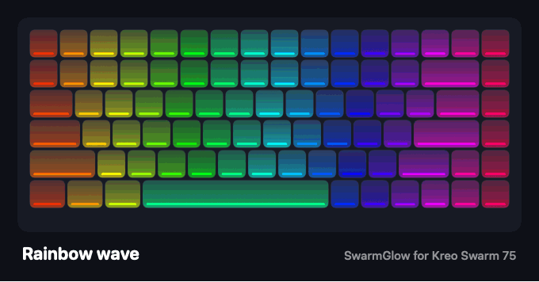
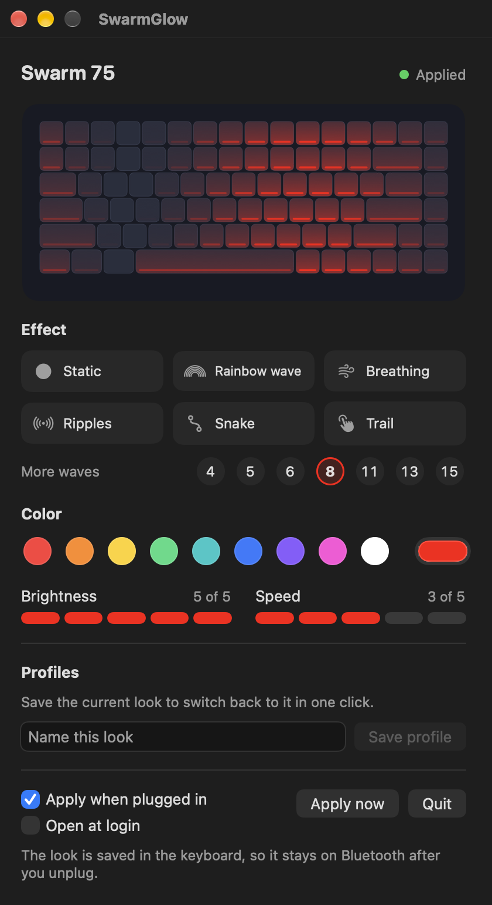
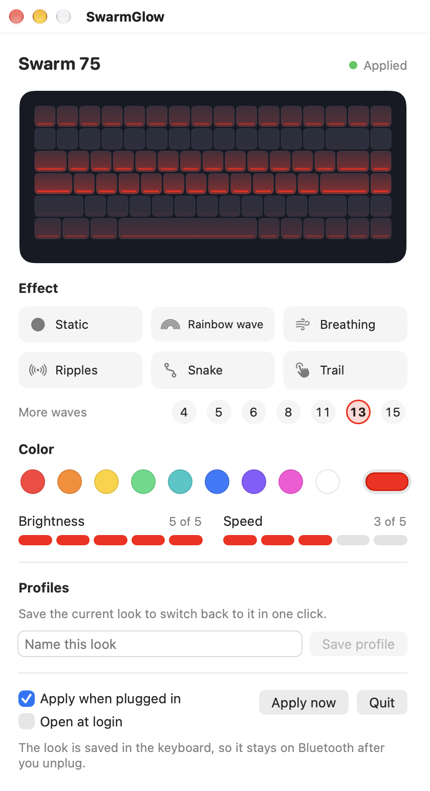

# kreo-swarm75-mac

**SwarmGlow:** control the RGB lighting of a **Kreo Swarm 75** keyboard from your Mac.
Kreo's own software is Windows-only; this is the missing Mac app, plus a CLI and a web page.

<p align="center">
  
</p>

<p align="center">
  <a href="https://github.com/JScoder4005/kreo-swarm75-mac/releases/latest"><b>Download SwarmGlow for macOS</b></a>
  &nbsp;·&nbsp; free and open source (MIT) &nbsp;·&nbsp; Apple Silicon and Intel, macOS 14+
</p>

- **SwarmGlow**, a native macOS app: pick a color, effect, brightness and speed, see it on a live keyboard
  preview, save profiles, and it **applies automatically when you plug the keyboard in**
- A command-line tool: `kreo set --color ff0000 --mode static --brightness 80`
- A web page (WebHID, Chrome) with the same controls
- Protocol notes, decoded from a Windows capture and tested byte by byte on real hardware

> **Status:** works over **USB**. The look is stored in the keyboard, so it stays after you unplug and switch to
> Bluetooth. **Live control over Bluetooth is not possible**, not even with Kreo's own software
> (see [Limitations](#limitations)). Tested on one keyboard and one Mac. Not affiliated with Kreo.

## SwarmGlow (macOS app)


<p align="center">
  
  &nbsp;
  
</p>

**Install:**

1. Download `SwarmGlow-0.1.2.zip` from the [latest release](https://github.com/JScoder4005/kreo-swarm75-mac/releases/latest), unzip it, and move **SwarmGlow.app** to **Applications**.
2. Open it. macOS will say it can't verify the developer, because the app isn't notarized by Apple.
   Go to **System Settings > Privacy & Security**, scroll down, and click **Open Anyway**. You only do this once.
3. Turn on **SwarmGlow** under **System Settings > Privacy & Security > Input Monitoring**, then reopen it.
   The lighting interface shares a USB interface with the keys, so macOS treats it like keyboard access.
   SwarmGlow only sends lighting reports and never reads keystrokes.
4. Plug in the cable and set the keyboard's mode switch to **USB/wired** (the cable alone only charges).
   Your look applies automatically. Unplug and it stays on Bluetooth.

It only talks to keyboards that identify as "Kreo Swarm"; the Kreo Hive 75 and Hive 98 share the same USB ID
but were never tested, so they are refused.

**Build it yourself:** `cd macos && ./make-app.sh` (needs Xcode). The script signs with a keychain identity
named `Kreo Local Signing` if you have one (a self-signed code-signing certificate), so the Input Monitoring
permission survives rebuilds; otherwise it signs ad hoc and you re-allow after each build.

## CLI and web page

```sh
git clone https://github.com/JScoder4005/kreo-swarm75-mac.git
cd kreo-swarm75-mac
python3 -m venv .venv
.venv/bin/pip install -r requirements.txt      # installs hidapi, nothing else
```

Plug the keyboard in with the cable and its switch on USB (Bluetooth does not expose the lighting interface).
If macOS blocks access, allow your terminal under **System Settings > Privacy & Security > Input Monitoring**.

### Command line

```sh
bin/kreo set --color ff0000 --mode static --brightness 80
bin/kreo set --color 00aaff --mode breathing
bin/kreo set --mode rainbow-wave --speed 40
bin/kreo set --mode 11                      # any effect number 1-15
bin/kreo modes                              # list named effects
bin/kreo set --color 00ff00 --dry-run       # print the reports, send nothing
```

| Option | Values |
|---|---|
| `--color` | `RRGGBB` hex. Ignored by rainbow effects |
| `--mode` | `static`, `rainbow-wave`, `breathing`, `ripple`, `snake`, `trail`, or a number 1-15 |
| `--brightness` | 0-100 |
| `--speed` | 0-100, animated effects only |
| `--raw INDEX=VALUE` | override one byte of the mode report (for experiments) |

### Web page

```sh
cd web && python3 -m http.server 8765 --bind 127.0.0.1
```

Open `http://127.0.0.1:8765/` in **Chrome** (or Edge; Safari and Firefox have no WebHID), click **Connect keyboard**
and choose *Kreo Swarm*. The preview works without a keyboard attached; the status line tells you whether anything
was actually sent.

## What was decoded

Full detail and evidence in [PROTOCOL.md](PROTOCOL.md).

| Setting | Where | Values |
|---|---|---|
| Color | report `06 0A`, bytes 29-31 | R, G, B |
| Effect | report `06 04`, byte 18 | 1-15 (see the table in PROTOCOL.md) |
| Speed | report `06 04`, byte 19 | `0x00` slow, `0x08` medium, `0x80`+ fast (clamps) |
| Brightness | report `06 04`, byte 31 | `0x10` dim to `0xFF` full |

Only two report types are ever sent: `06 0A` (palette) and `06 04` (mode), each 520 bytes, in the exact format
captured from the Windows app. Nothing else is sent: no firmware commands, no unknown report IDs.

## Limitations

- **USB only.** Over Bluetooth the keyboard shows up as a different device (`0x3554:0xFA07`) whose only vendor channel
  is a 19-byte report (ID `0x13`). Even Kreo's own software only configures it over USB or the 2.4 GHz receiver.
  Settings saved over USB stay active on Bluetooth.
- **Effect names are partial.** Several "wave" effects (4, 5, 6, 8, 11, 13, 15) look alike; only six have names.
  There is no direction setting on this keyboard.
- **Speed and brightness steps are approximate.** The exact clamp point for speed and what brightness `0` does are untested.
- The web preview **approximates** the effects; it is a simulation, not a read-back from the keyboard.
- **Key remapping** is not implemented and has not been investigated.
- One keyboard, one macOS machine. Firmware revisions may differ.

## Development

```sh
.venv/bin/python -m unittest discover -s tests -t .     # protocol builder tests (no hardware)
node tests/web_parity.mjs                               # JS builder produces the same bytes as Python
(cd macos && swift test)                                # Swift builder produces the same bytes as Python
.venv/bin/python tools/probe.py --index 18 --values 1,2,3 --hold 6    # sweep a byte, restores static red after
(cd macos && swift run KreoSnapshot gif ../docs/swarmglow-demo.gif)   # regenerate README images (also: screens, icon)
```

```
macos/       SwarmGlow app (KreoCore protocol + tests, KreoUI, SwarmGlow target, make-app.sh)
kreo/        protocol builder, device access, CLI
web/         WebHID page (index.html, app.js, preview.js, protocol.js)
tools/       pcap extractor (stdlib), byte probe helpers
tests/       unit tests
PROTOCOL.md  decoded protocol and evidence
```

## Credits

The USB IDs, the vendor interface and the first working report replay come from
[yashsinghcodes/kreo-backlight](https://github.com/yashsinghcodes/kreo-backlight), whose Windows capture this
project analysed. That repository has no license, so its code and capture are not copied here.

## Disclaimer

Sends HID feature reports to your keyboard. The reports match the captured format and were limited to the
lighting commands, but use it at your own risk.

## License

[MIT](LICENSE)
